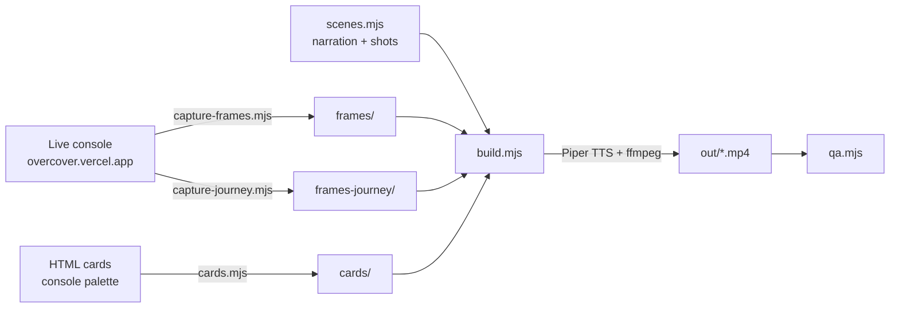

# PR body — feat/overcover-company-film → main

Copy the block below into the pull request. Base: `main`. Head: `feat/overcover-company-film`.

---

## What this adds

A **~3 min 09 s, 1920×1080, 30 fps, stereo** narrated company film for institutional and technical
audiences — built entirely from the **live production console** and HTML-rendered cards, with every
on-screen and narrated claim mapped to evidence.

This is a **new, focused PR**. It contains no product-code changes.

**This update adds a scene (05) that shows the customer purchase journey and the real on-chain
purchase that proves it works** — and states plainly that the purchase was signed by the project's
agent, with the human-wallet signature named as the outstanding acceptance step. See
`reports/VIDEO_CUSTOMER_JOURNEY_EVIDENCE.md`.

## Deliverables

| Path | What it is |
| --- | --- |
| `video/company/out/overcover-company-film-web.mp4` | The film, web-optimised (1920×1080, stereo AAC) |
| `video/company/out/poster.png` | 1920×1080 poster frame |
| `video/company/scenes.mjs` | Single source of truth: narration + shot list |
| `video/company/{capture-frames,capture-journey,cards,build,remux,qa,validate-cards,verify-cards}.mjs` | Reproducible pipeline |
| `video/company/out/qa.json` | Machine-readable QA (hashes, codecs, loudness) |
| `reports/VIDEO_STORYBOARD.md` | Creative direction + shot-by-shot script |
| `reports/VIDEO_CLAIM_VERIFICATION.md` | Every claim → its evidence, + an explicit "not claimed" table |
| `reports/VIDEO_CUSTOMER_JOURNEY_EVIDENCE.md` | What the purchase journey proves — and that no human-wallet purchase exists |
| `reports/VIDEO_QA_REPORT.md` | Independent QA of the shipped file |
| `reports/VIDEO_HUMAN_ACTIONS_REQUIRED.md` | The three human/external items outstanding |

The **62 MB master** (`overcover-company-film.mp4`) is git-ignored (regenerable); its path and
SHA-256 are recorded in `reports/VIDEO_QA_REPORT.md`.

## How the film is made

Narration length drives picture length: each scene is synthesised first, then its shots are rendered
with a slow Ken-Burns move and crossfaded. Change the film by editing `scenes.mjs` and re-running the
pipeline.

## Verification (independently measured from the shipped file)

| Check | Result |
| --- | --- |
| Full decode | clean, exit 0, no error output |
| Black frames | **0** |
| Loudness (EBU R128) | **−15.5 LUFS**, True Peak −1.1 dBTP |
| Audio | **stereo**, 48 kHz, present across the timeline (incl. scene 05) |
| Scene order | matches the storyboard (perceptual-hash timeline) |
| Card scenes | aHash distance 0–1/256 to the intended card |
| Scene 05 sources | aHash distance 0–19/256 to the intended card/frame |

- **Master** `5f6e5758…ca2d0d` · **Web** `41607d5c…4c692e` · **Poster** `87ef3b55…2f21b0`
- Reproduce: `cd video/company && node capture-frames.mjs && node capture-journey.mjs && node cards.mjs && node build.mjs && node qa.mjs`

## Honesty

- Product footage is the **live console**; figures are read from `contract.ovc-v3-ctl-2f6c4c.testnet`.
- The film states the deployment is **NEAR testnet** and **unaudited**.
- The attestation/TEE layer is described as a **prototype**, and the film states that execution
  integrity is not proof that an observation is true.
- Scene 05 shows the **real** on-chain purchase (`buy_cover` tx `45A1s3hz…` → policy #3, `active`)
  and states on the card that it was **signed by the project's agent**; a human-wallet purchase is
  named as the outstanding acceptance step. **No human-wallet purchase is claimed** — none exists.
- **No** endorsement, funding, partnership, user count, revenue or capital-under-management is claimed.
- `reports/VIDEO_CLAIM_VERIFICATION.md` lists the claims deliberately **not** made, and why.

## Limitations (honest)

- The QA is **programmatic**; a human should still watch the master end-to-end before release.
- Authored for a 16:9 screen. On a 390 px phone the smallest card labels scale to ≈4 px and are not
  readable — a deliberate composition trade-off.
- Narration is synthesised (Piper `en_US-lessac-medium`), not a human voice actor.

## Not touched

- No change to `contract/`, `driver/`, `ui/`, `agent/`, tests, or deployment config.
- PR #39 and PR #51 are left as-is.

---

_This PR was created by an AI agent (OpenHands) on behalf of the repository owner._
